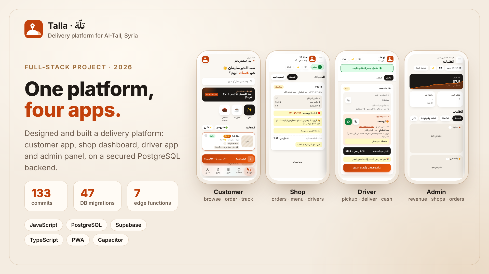
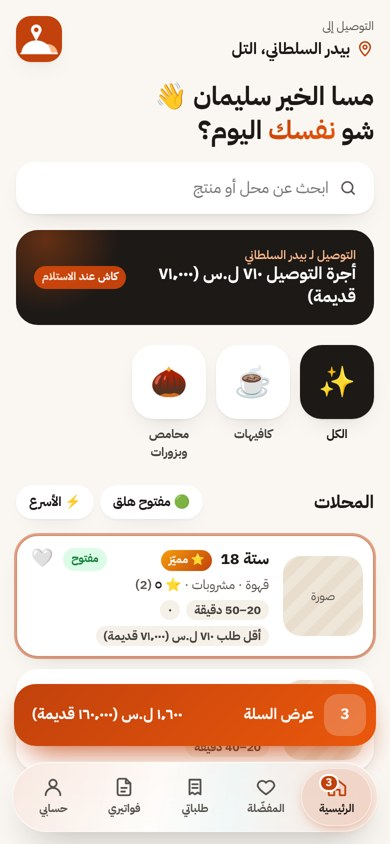
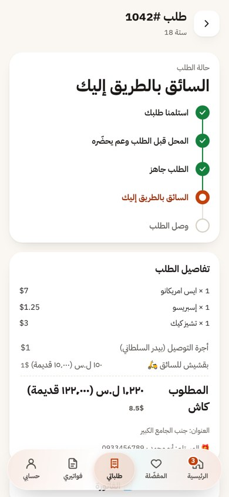
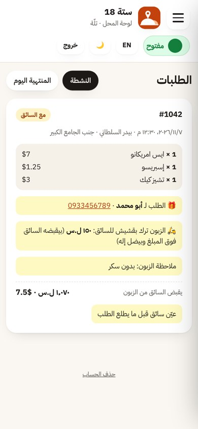
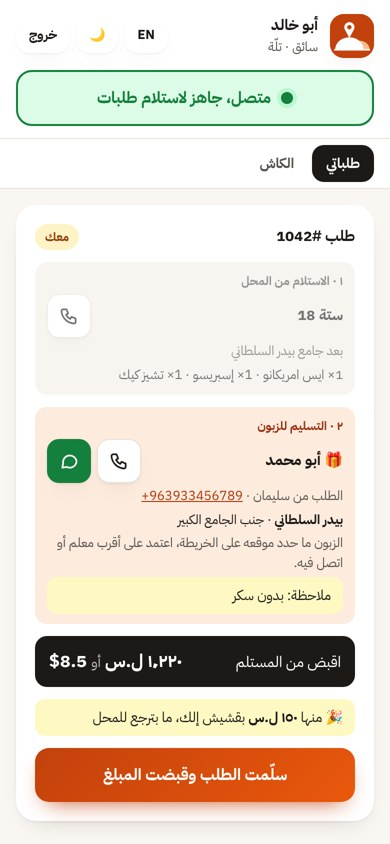
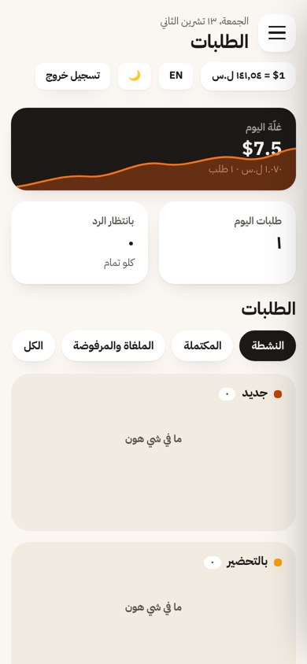
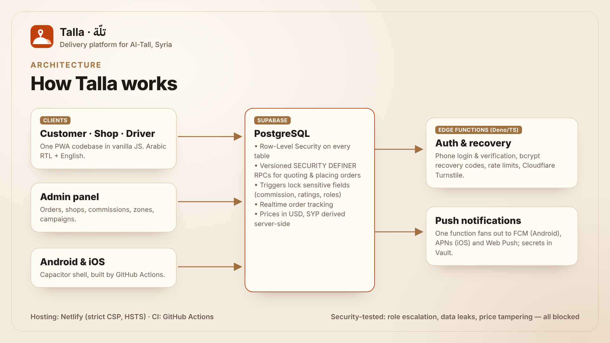
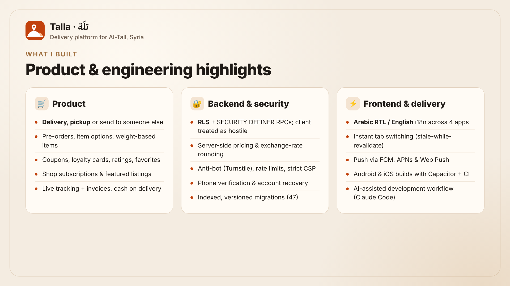

# Talla · تلّة — delivery platform for Al-Tall, Syria

**Talla** connects customers in Al-Tall (rural Damascus) with local restaurants, groceries, cafés,
pharmacies and roasteries. Customers order for **delivery**, **pickup**, or **for someone else**, track
the order live and pay **cash on delivery**. Shops run their own menu and drivers; an admin panel runs
the whole marketplace.

> The production code lives in a private repository. This repo is a public showcase: architecture,
> screenshots and selected, cleaned-up code samples.

| | |
| --- | --- |
| **Status** | Live web app in early beta (first shops and users onboarded); Android & iOS builds prepared, not yet in the stores |
| **Started** | October 2026 |
| **Scale of the codebase** | 133 commits · 47 database migrations · 7 edge functions · ~17k lines |
| **My role** | Solo founder — product, design, full-stack development, marketing |

## Screens

| Customer | Order tracking | Shop dashboard | Driver | Admin |
| --- | --- | --- | --- | --- |
|  |  |  |  |  |

*Screens were captured from a local test build with made-up names and phone numbers. The interface is Arabic (RTL) first, with an English switch.*

## Architecture

- **One PWA codebase** (vanilla JavaScript ES modules, no framework, no build step) serves customers,
  shops and drivers; a separate admin panel shares the same i18n and theme modules.
- **Supabase / PostgreSQL** holds all business rules. The browser only has the publishable key, so every
  client is treated as hostile:
  - Row-Level Security on every table.
  - Orders are quoted and placed through **versioned `SECURITY DEFINER` RPCs**
    (`quote_order`, `place_order_v6`, …) — a new signature gets a new version so deployed apps keep working.
  - Triggers lock fields a shop owner must never change (commission, featured status, ratings, roles).
  - Prices are stored in USD; Syrian-pound prices are derived server-side from the admin's exchange rate.
- **Edge functions (Deno / TypeScript)**: phone login and verification, account recovery with bcrypt codes
  and rate limits, Cloudflare Turnstile, and one push function that fans out to **FCM, APNs and Web Push**.
- **Delivery**: Netlify (strict CSP, HSTS) for the web apps; **Capacitor** + GitHub Actions for Android/iOS.

## Highlights

## Code samples

These are files taken from the production codebase to show how things are built. They depend on the
rest of the schema (tables, helper functions, settings) and are not meant to run on their own.

| File | What it shows |
| --- | --- |
| [`samples/sql/place_order_v6.sql`](samples/sql/place_order_v6.sql) | Versioned order RPC: input validation, delivery-only tip, server-side currency rounding, grants |
| [`samples/sql/rls_and_field_protection.sql`](samples/sql/rls_and_field_protection.sql) | Column-level protection trigger (function + `CREATE TRIGGER`) and RLS policies |
| [`samples/edge-functions/send-push.ts`](samples/edge-functions/send-push.ts) | Full push function: Web Push / FCM / APNs fan-out, shared-secret auth, new orders, status updates, campaigns |
| [`samples/frontend/i18n.js`](samples/frontend/i18n.js) | Tiny i18n: the Arabic string is the key; [`i18n-en.js`](samples/frontend/i18n-en.js) is a sample of the English dictionary |

## Security testing

Before opening the app to users I ran manual attack tests against the live API as an anonymous visitor,
a customer and a shop owner: role escalation, fake phone verification, reading other users' orders,
changing prices / exchange rate / commission / ratings, calling admin RPCs and faking payments.
Every attempt in that test set was rejected by the database. Gaps found along the way (e.g. fake shop
ratings, a shop changing its own type) were fixed with new migrations. This is not a formal audit.

## How I built it

I built Talla with an **AI-assisted workflow**: I designed the product and data model, wrote the
requirements, and worked with an AI coding agent (Claude Code) to implement, review and test changes —
with project rules (`CLAUDE.md`), a migration-guard hook and a security-review sub-agent for every
database change. I reviewed, tested and shipped every change myself.

## Tech

JavaScript · HTML · CSS · PostgreSQL / PL/pgSQL · Supabase (Auth, RLS, Realtime, Vault, Edge Functions) ·
TypeScript (Deno) · Capacitor · GitHub Actions · Netlify · Web Push / FCM / APNs · Cloudflare Turnstile
